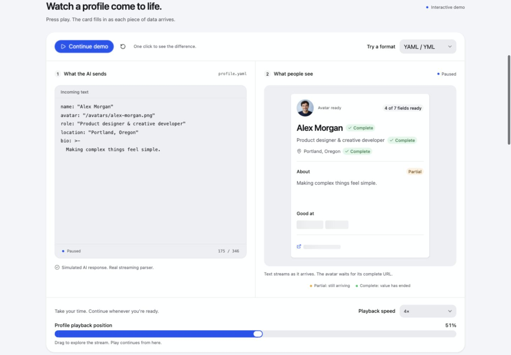
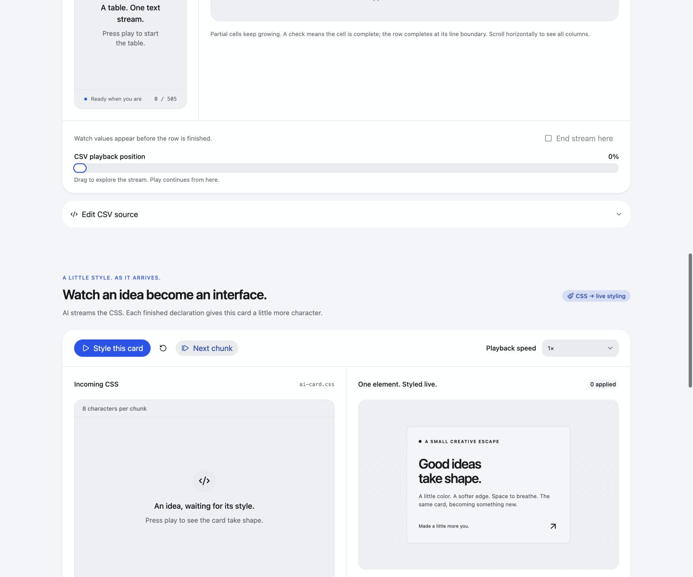

# TetraStream

**Structured data, as it arrives.**

[](https://github.com/N1XUS/tetraStream/actions/workflows/ci.yml)
[](LICENSE)

[Live demos](https://tetrastream.severyn.pro/) · [Usage guide](https://tetrastream.severyn.pro/guide/) · [npm package](https://www.npmjs.com/package/tetra-stream)

TetraStream is a TypeScript library for turning an unfinished text stream into useful structured data. Render a name while it is still being generated, add table cells before a CSV row ends, or wait for a complete avatar URL before loading an image.

It supports **JSON, YAML, XML, HTML, JSON Lines, CSV, TSV, and CSS**, with explicit partial/complete metadata. The parser is independent of your AI provider, transport, and UI framework.

## Parser-free client and server transport (unreleased)

The source branch adds `tetra-stream/client` and `tetra-stream/server`; these subpaths are not part of the published `0.2.0` package yet. Build/install the repository archive to try them before the next npm release.

Keep raw model text and structured wire frames separate. The server parses model deltas once; browsers receive `WireBatch` objects containing existing `PatchBatch` operations. The client entry includes no format parsers, schema engine or third-party runtime dependencies. `npm run check:client-size` bundles every public client export and enforces an 8 kB gzip budget.

Server, in a fetch-compatible handler:

```ts
import { toEventStream, eventStreamResponse } from 'tetra-stream/server';

// Replace this generator with your provider's decoded text deltas.
async function* generatedText() {
  yield '{"customer":{"name":"Al';
  yield 'ex"},"items":[{"price":12.5}]}';
}
export function POST(request: Request): Response {
  const batches = toEventStream(generatedText(), {
    format: 'json',
    schema: { type: 'object' },
    signal: request.signal,
  });
  return eventStreamResponse(batches, {}, { signal: request.signal });
}
```

Browser TypeScript:

```ts
import { fromSSE, createPatchState, applyPatchBatch, select } from 'tetra-stream/client';

type Order = { customer: { name: string }; items: { price: number }[] };
// HTML: <h2 id="customer-name">Waiting…</h2>
const heading = document.getElementById('customer-name');
if (!heading) throw new Error('Missing #customer-name');
const state = createPatchState<Order>();
try {
  const response = await fetch('/api/order', { method: 'POST' });
  for await (const batch of fromSSE(response)) {
    applyPatchBatch(state, batch);
    const name = select(state, '/customer/name', { require: 'complete' });
    if (name.status === 'complete') heading.textContent = name.value;
    // state.issues records schema/production issues independently of completion.
    if (state.state === 'error') console.error(state.error);
  }
} catch (error) {
  console.error('Keep the last rendered value:', error);
}
```

Use `toNDJSON` / `ndjsonResponse` on the server and `fromNDJSON` on the client for the alternative UTF-8 line transport. The terminal `complete` or `error` frame ends the stream; EOF alone never means success. Readers bound frames, reject gaps, preserve split Unicode, support `AbortSignal` and cancel unused bodies. Client application is atomic: an invalid target leaves the accumulator unchanged. The optional `{ appendOnly: true }` reducer policy rejects `remove` operations.

`schema` is a serializable JSON Schema descriptor and is never fetched or executed automatically. For runtime validation, provide a separate Standard Schema `validator` option to `toEventStream`; it validates only the finished document, does not coerce or replace raw values, and emits path-scoped `issues`. Manual producers may emit issues while siblings continue. Syntax/source failures produce terminal error frames with the useful partial data preserved.

For resume, retain the accumulator and pass `{ afterSequence: state.sequence }` to the reader while requesting replay using `Last-Event-ID`. Replay storage, unavailable-cursor handling and reconnect policy belong to your application. These helpers do not automatically reconnect.

Read the [wire v1 specification](libs/tetra-stream/spec/README.md) and [published frame schema](libs/tetra-stream/spec/patch-batch.schema.json). JSON and JSON Lines are wire v1; other formats remain supported in process.

## Install

```sh
npm install tetra-stream
```

An early `0.2.x` release with ESM output and TypeScript declarations. The built library supports modern browsers and Node.js 20+. See the [library documentation](libs/tetra-stream/README.md) for the full API.

## See the difference

```ts
import { Format, StreamNormalizer, select } from 'tetra-stream';

interface Profile {
  name: string;
  bio: string;
}
const parser = new StreamNormalizer<Profile>({ format: Format.JSON });

const first = parser.write('{"name":"Alex Morgan","bio":"Making com');
console.log(first.data?.name); // Alex Morgan
console.log(first.data?.bio); // Making com
console.log(first.status['/name']); // complete
console.log(first.status['/bio']); // partial

const bio = select(first, '/bio', { require: 'complete' });
console.log(bio.status); // pending: no value exposed in this snapshot

parser.write('plex things simple."}');
const final = parser.end();
console.log(final.state); // complete
console.log(final.data?.bio); // Making complex things simple.
```

`select()` reads the supplied snapshot synchronously. `require` checks its current completion; returned selections are fixed results. Call it again with the next snapshot to update the UI.

A syntactically complete field can be used while the rest of the response is still arriving. Completion does **not** prove that required fields exist or that your application schema is valid. Runtime schema validation is available separately.



## Try the demos and guide

Development requires **Node.js 24+** and npm. The library's built ESM output supports **Node.js 20+** and modern browsers.

```sh
git clone https://github.com/N1XUS/tetraStream.git
cd tetraStream
npm ci
npm run dev
```

Open the local URL printed by Vite, normally `http://127.0.0.1:5173/`.

- **User card:** nested contact objects, project arrays with nested stack arrays, completion badges, and an avatar that requires its full URL.
- **CSV table:** growing headers, rows, and cells, with stable collection identities.
- **CSS styling:** streamed declarations progressively style a separate preview element.
- **Playback:** play, pause, reset, step, change speed, or scrub to any point in a response.
- **Usage guide:** open `/guide/` for complete HTML/TypeScript examples, transport adapters, an RxJS `generate` recipe, rendering, completion policies, patches, validation, and Rivet integration.

The demos use simulated AI text and the real parser. No API key or backend is required. The sample portrait is AI-generated and depicts a fictional person.

The site uses [RivetJS](https://github.com/N1XUS/rivetjs) and [Rivet UI](https://github.com/N1XUS/rivetjs/tree/main/libs/ui). They are development dependencies of the demo, not dependencies of the parser package.

## Stream CSS into a separate preview

The CSS example parses a stylesheet tree while the AI is still generating it. The preview applies finished, supported visual declarations to one fixed element. Partial values stay visible in the source/inspector; scrubbing backward restores the earlier appearance.



## Install the library from source

From this repository:

```sh
npm ci
npm run pack
```

Then, inside your application, install the generated archive:

```sh
npm install /absolute/path/to/tetraStream/artifacts/tetra-stream-0.2.0.tgz
```

The archive contains ESM JavaScript, TypeScript declarations, package metadata, README, and license. It excludes workspace source, tests, demos, and build tools. See [the package README](libs/tetra-stream/README.md) for the full API and format contracts.

The playground's downloadable archive is generated automatically before `dev` and `build`. Generated archives are not committed.

## Connect an AI stream

Use `streamStructured<T>(chunks, options)` with an `Iterable<string>` or `AsyncIterable<string>` of **decoded document text**. Each yielded snapshot can update your interface immediately; the adapter calls `end()` when input finishes.

The HTTP body does not need to contain a finished document before you consume it. For SSE, decode the event frames and extract their text deltas first. A complete event envelope can carry an unfinished piece of JSON, CSS, or another supported document. The guide includes a tested SSE adapter and an explicit example event contract. [SSE framing is defined by the HTML standard.](https://html.spec.whatwg.org/multipage/server-sent-events.html#event-stream-interpretation)

Your application supplies the provider request or endpoint. TetraStream does not call an AI service, decode arbitrary provider-specific event envelopes, or combine interleaved tool calls.

## Supported formats

| Format option     | Data shape                         | Streaming behavior                                                                                 |
| ----------------- | ---------------------------------- | -------------------------------------------------------------------------------------------------- |
| `json`            | Objects, arrays, scalars           | Decoded strings and available scalar prefixes appear progressively.                                |
| `yaml`, `yml`     | JSON-compatible data               | Maps, sequences, and scalars; one document, with prefix reparsing.                                 |
| `xml`, `html`     | Ordered document/element/text tree | Text grows inside elements; attributes appear after the opening tag is complete.                   |
| `ndjson`, `jsonl` | Array of records                   | Includes the current partial record.                                                               |
| `csv`, `tsv`      | Array of string rows               | Includes the header row; cells and rows have independent completion states.                        |
| `css`             | Stylesheet/rule/declaration tree   | Selectors and declaration values appear progressively; completed declarations can drive a preview. |

Paths use JSON Pointer, such as `/bio`, `/skills/0`, or `/1/0`. Markup and CSS use paths through their tree structures. Format-specific data remains explicit; the library does not silently turn every document into a profile object.

## APIs at a glance

| API                                    | Use it for                                                                 |
| -------------------------------------- | -------------------------------------------------------------------------- |
| `StreamNormalizer<T>`                  | Direct `write`, `end`, and independent `snapshot` access.                  |
| `streamStructured<T>`                  | Async or sync text chunks → progressive snapshots.                         |
| `select(snapshot, path, options)`      | Typed field paths with partial, complete, or document visibility policies. |
| `streamPatches` / `writePatch`         | Changed paths and decoded string suffixes for larger responses.            |
| `createPatchState` / `applyPatchBatch` | Ordered replay into a consumer-owned accumulator.                          |
| `streamValidated` / `validateSnapshot` | Standard Schema V1 validation after successful document EOF.               |

`data` is `DeepPartial<T> | undefined`. A generic type provides compile-time expectations, not runtime validation. Only the narrowed `validation.value` is validated schema output. Catch source/parse failures and keep the last useful UI state; a direct parser retains data and its error in `snapshot()`.

## Workspace

```text
libs/tetra-stream/     Publishable parser library, declarations, and tests
apps/playground/       RivetJS/Rivet UI demos and multi-page usage guide
tools/                TypeScript packaging and consumer checks
docs/                 Contribution, release, and component notes
```

All authored application/library source, tests, benchmarks, and tools are TypeScript (`.ts`, `.tsx`, or `.mts`) with strict checking. Library source imports ending in `.js` deliberately refer to the emitted ESM paths. Generated `dist` JavaScript is the runtime package output.

```sh
npm run serve           # Production static site at http://127.0.0.1:4173
npm run build           # Library, preview archive, demos, and guide
npm test                # Parser, bindings, examples, and transport adapters
npm run typecheck       # Strict source/test/tool types and public API fixtures
npm run verify:package  # Install the archive in an isolated TypeScript consumer
npm run benchmark      # Local snapshot/patch comparisons
```

Rivet prerenders the homepage and guide into `dist/apps/playground/client/`. The Cloudflare adapter writes the deployable static site and Wrangler configuration to `dist/apps/playground/cloudflare/`. Ordinary pushes run verification and do not publish to npm.

## Boundaries

- TetraStream parses one ordered document. It does not repair arbitrary model output, strip Markdown fences, reconnect transports, or reconcile model retractions.
- Snapshots clone accumulated data. Patches reduce repeated output copying, but the parser and accumulator still retain the document.
- YAML and CSS prefix reparsing add work as the input grows. Throttle updates for large workloads; see the format-specific package documentation.
- Parsing HTML is not sanitization. Applying generated styles, URL policies, schema choice, cancellation, and side effects belong to the application.
- Benchmarks are workload-dependent. No advantage over other libraries is claimed.

## Contribute and release

See [CONTRIBUTING.md](CONTRIBUTING.md), [release instructions](docs/RELEASING.md), and [the security policy](SECURITY.md). Report reproducible bugs or propose features through [GitHub Issues](https://github.com/N1XUS/tetraStream/issues).

## License

[MIT](LICENSE).

## Custom language strategies

Built-in languages are exposed as the runtime `Format` enum: `Format.JSON`, `Format.XML`, `Format.HTML`, `Format.YAML`, `Format.YML`, `Format.NDJSON`, `Format.JSONL`, `Format.CSV`, `Format.TSV`, and `Format.CSS`. Existing string spellings remain supported; `FormatName` is their string union.

Pass an instance implementing `LanguageStrategy<T>` as `format` to add a language without global registration. The model is inferred, and each stream gets its own parser:

```typescript
import { Format, StreamNormalizer, streamStructured } from 'tetra-stream';
import type { LanguageStrategy, LanguageParser, LanguageUpdate } from 'tetra-stream';

// Built-in formats have runtime enum values. String spellings still work.
const json = new StreamNormalizer({ format: Format.JSON });
json.write('{"name":"Al');

interface Message {
  text: string;
}
class PlainTextStrategy implements LanguageStrategy<Message> {
  readonly format = 'plain-text';
  create(): LanguageParser<Message> {
    // This state belongs to one stream, never to the strategy instance.
    let text = '';
    const result = (complete: boolean): LanguageUpdate<Message> => ({
      data: { text },
      status: {
        '': complete ? 'complete' : 'partial',
        '/text': complete ? 'complete' : 'partial',
      },
    });
    return {
      write(chunk) {
        text += chunk;
        return result(false);
      },
      end() {
        return result(true);
      },
    };
  }
}

// The output model is inferred from the strategy.
for await (const snapshot of streamStructured(['Hello, ', 'world!'], {
  format: new PlainTextStrategy(),
})) {
  const text: string | undefined = snapshot.data?.text;
  console.log(text, snapshot.status['/text'], snapshot.state);
}
```

`create(options)` receives readonly `maxLength` and `maxDepth`. Return a fresh synchronous `LanguageParser<T>` with `write(chunk)` and `end()`. Both return `LanguageUpdate<T>` containing `DeepPartial<T> | undefined` data and a completion map keyed by RFC 6901 JSON Pointer. `end()` must validate the original document and mark finished values complete; throw on invalid syntax. Input length is enforced by the normalizer. Your strategy must enforce nesting depth and its own grammar.

Return JSON-compatible plain data: strings, finite numbers, booleans, null, dense arrays, and objects with enumerable data properties. Omit unavailable fields rather than assigning `undefined`; only the entire `data` result may be `undefined`. Cycles, shared object references, sparse arrays, getters, symbols, and class objects are rejected before commit. Output tree depth is also checked against `maxDepth`. Results are copied before ownership transfers, so parsers may reuse their mutable working trees. Snapshots, selection, schema validation, and patch replay work with custom formats. Patch mode diffs the returned tree; it does not provide the built-ins' direct mutation-journal performance. Use the strategy or its `format` string with `createPatchState({ format: strategy })`.

## Deploy the static site

The playground uses `rivetRouter({ mode: 'static', adapter: 'cloudflare' })` with the official Rivet Nx build executor. It renders both routes to HTML at build time; Cloudflare serves static assets without an application server.

```sh
npx wrangler login
npx nx run playground:deploy
```

The deployment target is `tetrastream.severyn.pro`, declared in `apps/playground/wrangler.jsonc`. Wrangler creates the custom-domain binding and DNS record in the authenticated Cloudflare account. See [deployment details](docs/DEPLOYING.md) for checks and repeat deployments.
